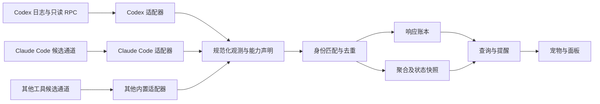

# AI 用量桌面宠物开发方案

版本：v0.3  
日期：2026-10-15  
适用平台：Windows  
项目目录：D:\project\宠物  
状态：多来源架构与桌宠体验基线修订稿；实现与验证状态以验收记录为准

本项目开发一个独立运行的桌面悬浮宠物，持续记录 AI 工具用量，帮助用户查看模型与项目消耗、接收回合结束提醒，并在来源支持时回到对应聊天。首版接入本机 Codex，通过统一适配器契约为 Claude Code 和其他工具预留扩展。宠物的统计、规则和动画在本地运行，不以额外调用模型作为运行依赖。

首版优先保证统计准确、采集可恢复、提醒有依据。性能指标按实际数据能力展示；无法证明的生成速度、等待状态和上下文剩余量不显示推断值。

v0.2 已补齐多来源数据契约；v0.3 根据 [7 个开源项目调研](docs/research/开源桌宠调研-2026-10-15.md)，细化表现层、内置资源契约、桌面交互恢复和资源生命周期。继续采用既定技术栈，不直接引入候选项目的完整运行时或角色素材。目录已有实现文件及 [M0 环境与发布门槛](docs/acceptance/M0-环境与发布门槛.md)；文档修订不代表现有实现已经满足新增契约，也不重置已有有效验收证据。

## 1 产品目标与范围

产品暂名“Token 喵”。名称和宠物形象可调整，统计能力与皮肤分离。

用户已确定采用独立桌面悬浮宠物，读取本机 Codex 用量。本方案将已调研功能收敛为以下版本范围；制定方案不代表这些功能已经实现或验收。

| 版本 | 纳入范围 | 完成条件 |
| --- | --- | --- |
| V1.0 | Codex 本机用量账本、缓存统计、回合耗时及可用的回合首 token 耗时、账户额度、悬浮宠物、统计面板、项目和子代理拆分、完成收件箱、聊天跳转、软预算、工具记录简表、采集健康、静音与隐私模式、CSV 导出；落实通用适配器与来源隔离契约 | 按 M0 至 M4 验收；只声明已验收的 Codex 接入 |
| V1.1 | 缓存与配置变化时间线、压缩记录、每日使用摘要、按条件分组的模型表现对比 | V1.0 数据契约稳定且对应数据覆盖足够 |
| 后续桌宠体验 | 校验后的本地皮肤导入、轻触反馈、受限移动、临时恢复交互 | 单独排期；不进入 V1.0 必交范围 |
| 扩展批次 A | Claude Code 适配器及必要的本机桥接 | 按第 12 节独立验收；不列入 V1.0 发布门槛 |
| 扩展批次 B | Gemini CLI 或自有应用的 API 用量接入 | 逐个来源确定范围，不承诺所有 AI 工具自动兼容 |
| 独立研究项 | 各来源的单请求生成速度、首可见文字延迟、持续待审批和待输入状态、OTel 性能采集、精确上下文占用 | 按适配器分别验证；某来源具备能力不代表其他来源具备 |

V1.0 不包含自动审批、自动停止 Codex 任务、自动切换模型、自动压缩聊天、修改 Codex 登录、重置额度、跨设备同步或云端账单系统。费用估算留待明确提供方、价格版本和计费口径后另行设计。

桌宠首版交付一个原创内置角色、五类基础动作与静态回退，不引入完整养成、资源商店、任意代码 MOD、语音视觉聊天或全局输入内容采集。角色成长不与 token 花费、请求数量或连续工作时长绑定，也不因用户少用 AI 施加惩罚。Live2D、VRM 和复杂桌面物理单独评估。

接入对象以具体工具与运行环境定义。Claude Code、Claude 网页聊天、Claude 桌面聊天和直接调用 Claude API 是不同来源；接入其中一种不代表覆盖其他来源。Windows 本机、WSL、远程主机和云端会话分别记录覆盖边界，不能从本机可读目录推断全账户活动。

## 2 已有依据与能力等级

本机调研版本为 codex-cli 0.147.0。以下是开发输入，不是产品验收结果。开发时保留已有有效证据，只补充未验证的契约与场景。

| 依据 | 已确认内容 | 约束 |
| --- | --- | --- |
| 6 个本机日志样本，1,053 条记录 | 125 条单响应用量记录具有输入、缓存读取、缓存写入、输出、推理输出和总量字段 | 仅证明样本字段覆盖；缓存写入样本均为 0，非零场景待验证 |
| 用量关系核验 | 125 条均满足输入加输出等于总量，缓存读取不大于输入，推理输出不大于输出 | 缓存与推理细分不能再次加进总量 |
| 回合完成记录 | 8 条记录去重后为 6 个回合，均有回合耗时及首 token 耗时 | 存在跨文件复制；首 token 字段属于当前日志能力 |
| 工具记录补充样本 | 43 条命令记录具有完成或失败状态、退出码；MCP 结果具有错误标记 | 工具结果不等于业务验收结果 |
| 独立 stdio 进程只读联调 | 账户读取、额度读取、账户用量汇总读取成功 | 认证方式、账户能力与版本变化需要兼容检测 |
| 本机生成的协议定义 | Token 通知、回合与条目时间字段可核对 | 未发现可直接用于单响应生成速度的完整计时字段 |
| 独立进程线程列表 | 桌面聊天运行时，该进程加载线程数为 0 | 新进程不能自动旁听桌面现有线程 |
| 官方聊天链接 | 已公布 codex://threads/<thread-id> | Windows 实际定位、无效目标及应用未启动场景待验收 |

为每个功能标记“已接入”“来源未提供”“待验证”或“暂不可用”。界面存在、协议存在与本机接入成功分别记录，不相互替代。

Claude Code 与 Gemini CLI 当前仅具备官方文档层面的可行性依据。实际接入需核对安装版本和采集字段，不能将文档能力标成已接入。具体候选通道与限制见第 8.4 节。

## 3 首版功能定义

| 编号 | 功能 | 具体行为 |
| --- | --- | --- |
| F01 | 用量概览 | 今日、近 7 天、近 30 天及自定义日期；分列输入、输出、总量、缓存读取、缓存写入、推理输出和已记录响应次数 |
| F02 | 缓存分析 | 展示按总量加权的命中率、读取量、写入量、普通输入量和字段覆盖率 |
| F03 | 回合时间 | 展示日志记录的回合总耗时、可用的回合首 token 耗时；缺失时明确显示未提供 |
| F04 | 项目与任务明细 | 按工具、来源实例、提供商、项目、模型、会话、根任务、主代理和子代理筛选；保留原始目录，支持本地配置将多个 worktree 归为一个项目 |
| F05 | 账户概览 | 分额度桶和窗口显示已用比例、剩余比例、下次重置时间及采集时间；账户日趋势与本机账本分开 |
| F06 | 完成收件箱 | 根回合结束后生成本地可回看的记录，区分正常结束、失败、中断和结果未知；子代理默认归入根任务详情；支持已读、筛选、清理本地提醒 |
| F07 | 聊天入口 | 从收件箱、会话明细和异常记录跳回对应聊天；无法定位时提供复制会话标识 |
| F08 | 软预算 | 按本地日、项目或任务设置 token 提醒阈值；默认只提醒，不改变 Codex 执行 |
| F09 | 工具记录简表 | 展示工具名称、类型、记录状态、退出码或错误标记、执行时长；不保存参数、命令正文及输出正文 |
| F10 | 来源与数据健康 | 显示各来源及通道的启用状态、能力、最后成功采集、历史覆盖范围、解析问题、未知模型和账户快照状态；未发布适配器不提供伪可用入口 |
| F11 | 桌宠体验 | 原创内置角色、透明悬浮、拖动、缩放、置顶开关、托盘、鼠标穿透与恢复、静音、免打扰、减少动画、隐私模式；不抢输入焦点，支持显示器变化后找回 |
| F12 | 数据管理 | CSV 导出、历史补导、本地数据保留设置、清理宠物自身数据；不删除 Codex 源文件 |

V1.0 展示来源明确记录的回合结果，不能把所有结束事件都归为成功。工具正常退出、模型正常结束、代码测试通过和业务目标达成是不同事实。产品不能依据前两项宣称后两项；缺少结果信息时显示“已结束，结果未知”。

## 4 交互与信息布局

界面分为三层，常驻层只显示必要信息。

| 层级 | 内容 | 操作 |
| --- | --- | --- |
| 悬浮宠物 | 当前最高优先级状态、少量提醒标记 | 拖动；单击展开小卡；右键打开菜单 |
| 统计小卡 | 今日 token、缓存命中率、最近回合首 token 耗时、账户额度与更新时间、待查看提醒数 | 进入详情；查看提醒；跳回聊天 |
| 主面板 | 概览、项目与会话、子代理、工具记录、收件箱、设置和数据健康 | 筛选、导出、配置预算、管理历史 |

宠物使用可替换的本地动画资源，当前角色选择沿用 M0 记录中的原创猫娘。先实现待机、活动、回合结束、提醒、休眠五组动画，角色资源与采集、账本和来源适配解耦。

运行状态与数据健康状态独立保存。读取正常但没有新事件，不等于采集失败；采集器异常也不等于 Codex 任务失败。

宠物状态遵循以下规则：

- 只有观察到明确的回合开始和后续活动，才显示有活动任务。
- 没有结束事件且来源长时间无法确认时，显示“状态待确认”，不无限显示正在运行，也不认定卡死。
- 根回合正常结束时触发一次完成动画；失败和中断使用对应文案与提醒动画，结果未知时不使用成功提示。多任务并行时，不能因一个回合结束而把全部任务设为空闲。
- 额度或软预算提醒属于独立提示，不覆盖任务事实。
- 数据未更新时显示时间，不把缺失数值填成 0。
- 开启穿透后必须能够从托盘或快捷键恢复交互。
- 隐私模式隐藏项目名、会话标题和路径，保留必要统计。

来源能力驱动界面：额度、聊天入口、上下文和性能指标分别判断是否可用。失败或未配置的 Claude 通道不影响 Codex 采集；某来源状态未知，不把所有来源统一设为空闲。跨来源总览明确展示纳入范围及排除原因，同一项目的多工具活动可以并排查看，但不自动合并为同一个根任务。

界面默认简体中文。时间按 Asia/Shanghai 展示与按日聚合，底层时间保存 UTC；后续切换显示时区应重算日期汇总，不改原始事件。

### 4.1 事实到表现的单向映射

采用“事实状态 → 展示意图 → 动画”的单向结构。事实来自统一账本与来源健康；pet_presenter 决定当前文字、角标和提示；animation_controller 决定动作阶段。皮肤和动画结束回调不能写回任务结果、额度或 token。

| 已知情况 | 展示规则 | 动画规则 |
| --- | --- | --- |
| 有活动根任务 | 显示活动数量，子代理另列；未知数量不估算 | 活动动作持续循环，同状态新事件不从头播放 |
| 某根回合正常结束 | 生成唯一收件箱记录；仍有其他任务时保留活动角标 | 短暂完成动作后按当前事实恢复 |
| 失败或中断 | 使用明确结果文字，与正常结束区分 | 提醒动作或静态提示，不能显示成功庆祝 |
| 结果未知或来源失联 | 显示“结果未知”或“状态待确认”及来源 | 不因沉默切换为完成或卡死；不确定状态保留可见标记 |
| 本地预算或额度提醒 | 独立提示，点击查看对应依据 | 限频播放，不替代活动与健康事实 |
| 免打扰 | 数据与收件箱继续更新，文字与角标可查看 | 禁止主动弹窗和声音，短提示不补播 |
| 减少动画 | 文字与角标继续表达当前事实，通知遵循独立设置 | 使用静态姿态，不靠动作才能读懂结果 |

多任务仲裁只选择当前表现，不删除其他任务事实。拖动、打开菜单和关闭动作立即响应；失败提示优先于普通完成提示；正常活动作为基础状态，额度与健康保持独立角标。需要等待输入的表现仅在适配器证据足够时启用。

提示队列有上限、事件身份、有效期和合并规则。重复、迟到事件或重启补读不反复播放；没有空余展示位的历史提示仍可在收件箱查看。普通动作设置最短停留时间和冷却，关键结果可以打断；具体时间在 M2 交互样例中固定，不使用表情闪切模拟实时性。

### 4.2 桌面输入与位置恢复

宠物常驻层保持小面积，统计小卡由用户操作展开，详细设置进入普通面板。启动、状态变化和完成提醒不自动夺取键盘焦点；打开主面板或明确输入时才激活对应窗口。置顶状态只在必要时更新，避免循环置顶影响任务栏菜单。

首版必须支持整体穿透与恢复：交互模式的有效区域可拖动或打开小卡，开启整体穿透后点击到达底层应用，并保留托盘与已注册快捷键恢复。透明像素的自动命中检测作为增强能力，需实机验证后开放；未开放时限制窗口边界并明确使用整体穿透，不声称透明空白天然穿透。始终保留“一键找回宠物”。

窗口位置保存显示器标识、工作区内逻辑位置和缩放，支持副屏负坐标。跨屏拖动结束后再校验，不在拖动中吸回原屏。拔屏、DPI 变化、远程桌面分辨率变化、睡眠恢复时重新计算可见工作区，显示器失效则回到有效屏幕；宠物与小卡都必须可见。首版不自动游走、移动其他窗口或读取其他应用内容。

文字状态、图标和颜色同时表达结果，不能只靠颜色或动作区分失败。静音默认开启；免打扰禁止主动弹窗；减少动画可独立配置。隐藏角色不会清除账本或停止必要采集，恢复角色直接展示当前状态。

### 4.3 内置皮肤与动作清单

首版只交付经过校验的内置 2D 资源。清单为数据，不是可执行插件；轻量 2D 渲染可以承载内置矢量/CSS 动作或受控图帧，首版只实现实际选定的一条渲染路径，并提供静态回退。保持原创角色选择，渲染器接口为后续形式留出边界。

| 清单内容 | 约束 |
| --- | --- |
| schema_version、skin_id、renderer_kind | 明确版本与兼容渲染器；未知版本拒绝启用 |
| 作者、来源、资源许可、署名文本 | 代码与素材授权分别记录；缺少分发依据不纳入安装包 |
| 尺寸、锚点、命中区域、静态预览 | 缩放不改变交互位置；预览失败不影响当前角色 |
| 语义动作与 start/loop/end 阶段 | 对应五类基础动作；允许省略过渡阶段，不允许无限阻止中断 |
| 帧时长、循环、回退映射 | 无效时长拒绝；回退有界且检测循环；始终有静态兜底 |
| 资源路径与完整性摘要 | 限本程序受控资源目录；不能指向脚本、外部 URL 或工具命令 |

显示结果文字由应用控制，皮肤不能把失败重命名为成功。动作结束只表示表现结束；由 presenter 决定接下来展示的状态。单包文件数、解码像素与缓存上限在 M2 资源验收前固定，受既有内存门槛约束。

本地皮肤导入的开发接口见 [本地 PNG 皮肤目录包 v1](docs/contracts/local-png-skin-v1.md)：包含预览、路径约束、大小与解码限制、许可提示和回退，不执行包内代码。2026-10-18 用户追加授权先开发 P1，本地 PNG 导入、保守透明区域命中与 15 秒临时交互已进入实现和定向检查；新 Windows App、原生交互、资源与安装验收仍待完成，默认内置角色与透明命中关闭保持为发布基线。Live2D 或 VRM 接入前分别核对 SDK、模型、动作及再分发条件，并验证资源成本，不把框架根许可证视为角色素材授权。

## 5 技术架构与模块

建议采用 Tauri 2、Rust、React、TypeScript 和 SQLite。前端构建使用 Vite，包管理使用 pnpm；精确依赖版本在 M0 核对环境后锁定。首版面向 Windows x64，其他平台不计入发布验收。

数据流为：

图中的 Claude Code 与其他工具是扩展结构，不代表首版已接入。响应账本、聚合用量、账户额度和上下文快照使用不同数据类型与查询口径。

| 模块 | 职责 |
| --- | --- |
| source_registry | 管理工具类型、运行环境、稳定来源实例、采集通道、能力与健康状态 |
| log_reader | 文件发现、共享只读打开、字节偏移续读、半行缓冲、移动与截断检测 |
| adapter_registry | 静态注册内置 SourceAdapter；按工具和版本选取适配器，不加载任意第三方可执行插件 |
| adapters/codex | Codex 的字段、身份域、计量语义、事件转换及读取能力 |
| adapters/claude_code | 后续实现 Claude Code 的通道整合和语义转换；其他适配器采用相同契约 |
| event_normalizer | 校验标准事件、粒度、单位、包含关系与来源证据；不猜测各提供商字段语义 |
| usage_ledger | 去重、事务写入、覆盖率与缺失记录、数据库迁移和恢复 |
| account_bridge | 按适配器调度白名单账户读取；Codex 实现管理自有隐藏 stdio 进程 |
| local_ingress | 后续桥接的本机接收与持久化入口，按来源认证、限流和隔离；V1.0 不启动未使用的监听器 |
| query_service | 模型、项目、日期、任务树及工具统计，生成可重建的聚合 |
| notification_engine | 完成收件箱、阈值提醒、限频、去重、静音和历史回放规则 |
| pet_presenter | 将已验证事实投影为展示意图，仲裁多任务文字、角标与短提示，不修改账本 |
| animation_controller | 语义动作、分段播放、冷却、打断、有界提示队列和减少动画策略 |
| pet_renderer / asset_registry | 内置 2D 资源清单、校验、加载、暂停、释放和静态回退；不依赖具体 AI 工具 |
| desktop_shell | 单实例、窗口、托盘、穿透、快捷键、聊天链接和应用生命周期 |
| frontend | 宠物动画与统计展示，不承担事实归因和去重 |

产品使用单个 Rust 后台写入者。前端通过有限的 Tauri 命令查询和修改宠物自己的设置，不开放通用文件读取、任意命令执行或任意外部链接执行能力。

建议代码目录：

    src/
      features/pet/
      features/overview/
      features/sessions/
      features/inbox/
      features/settings/
      shared/
    src-tauri/src/
      sources/
      adapters/
        mod.rs
        codex/
        claude_code/  （扩展批次 A）
      domain/
      storage/
      services/
      desktop/
    src-tauri/migrations/
    tests/fixtures/
    docs/acceptance/
    assets/pets/

### 5.1 最小适配器契约

SourceAdapter 采用内置 Rust 模块，首版只注册 Codex。通用层不依赖 Codex 的原始事件名称，也不直接拼接任何工具的配置路径或聊天协议。

| 契约 | 输入与输出 | 边界 |
| --- | --- | --- |
| discover / probe | 显式来源配置 → 工具版本、运行环境、候选通道、能力报告 | 发现只读，不创建模型请求或自动修改工具配置 |
| decode / normalize | 带物理定位的观测 → 标准事件或可诊断问题 | 只提取白名单元数据与计数；保留字段语义版本 |
| identity_policy | 原生 ID 与关联信息 → 唯一域、别名和匹配证据 | 声明哪些 ID 可关联同一请求，哪些仅在本进程或会话内有效 |
| capabilities | 来源版本与配置 → 分功能能力、粒度和前置条件 | 文档支持与本机验证分开，运行失效不改写历史能力证据 |
| read_account / list_sessions | 来源上下文 → 可选账户快照、会话元数据 | 不支持时明确返回；不得靠当前登录给历史补账户 |
| build_chat_target | 已验证会话身份 → 可选的受限跳转目标 | 由桌面层校验适配器允许的协议，不接受日志里的任意链接或命令 |

标准事件至少区分 ResponseUsage、TurnLifecycle、ToolLifecycle、UsageAggregate、QuotaSnapshot、ContextSnapshot 和 SourceHealth。每条观测携带来源及通道身份、原生 ID、事件时间、采集时间、版本、粒度、完整性和字段语义；缺少来源原生回合概念时不伪造回合关系。

### 5.2 能力声明与故障隔离

能力包括用量、缓存读取、缓存写入、推理细分、子代理、回合结束、请求计时、回合计时、额度、上下文和聊天入口。每项记录支持版本、通道、数据粒度、前置配置、证据与最近验证时间。

支持状态区分“本机已验证、仅文档支持、明确不支持、未知”；运行状态区分“可用、未配置、不可用、已过期”。因此已验证能力也可能因离线暂不可用，未配置不能显示成数值 0。单字段缺失不必关闭该来源所有统计。

每个来源采用有界队列和独立重试；解析失败、导出失败或退出一个工具，不阻断其他来源。首版用第二种语义的合成样本验证通用契约，不以此宣称真实 Claude Code 接入通过。

### 5.3 渲染生命周期与节能

动画调度与采集调度独立，动画帧不能触发日志全量扫描、数据库聚合或额度请求。状态变化走事件更新，周期采集按已有规则运行；同一动画状态重复到达时不重建场景和资源。

渲染器提供加载、呈现、暂停、恢复、销毁能力。内置资源按需加载并设置缓存上限；每次加载带代次，切换或关闭后的过期异步结果丢弃。卸载释放旧纹理、对象 URL、事件订阅、定时器和动画回调；预览与正式角色明确各自资源所有权。

可见时采用有上限的动画帧率；空闲降低装饰性变化。隐藏、锁屏或减少动画时暂停持续装饰动画，采集与持久化不因此停止。睡眠恢复后跳到当前状态，不追赶错过的帧或补播所有历史提示；电池节能模式优先静态显示。

若内置 2D 渲染未达到资源门槛，先检查重复循环、未释放资源和不必要刷新，再评估替代渲染实现。开源项目的框架迁移或性能宣传不构成本项目改栈的直接依据。

## 6 统计口径与数据契约

### 6.1 规范化后的 Token 指标

所有公式作用于适配器转换后的字段，不直接作用于名称相似的原生字段。令 I 为 input_total（输入总量）、C 为 cache_read、W 为 cache_write、O 为 output_total（输出总量）、R 为 reasoning_output。每个可选数值必须区分“有效数值、未提供、语义未确认、异常”，不能用 0 代表后三者。

| 指标 | 口径 |
| --- | --- |
| 总 token | I + O；仅当输入输出覆盖完整且两者互斥时生成 |
| 缓存 token 命中率 | ΣC / ΣI，按实际样本总量加权 |
| 非缓存读取输入量 | I − C，包含可能写入缓存的输入 |
| 普通输入量 | I − C − W；仅当三个字段及包含关系均有效时计算 |
| 推理输出 | R；仅在适配器确认后视为 O 的细分 |
| 非推理输出 | O − R；需确认包含关系，不能标为纯可见正文 |
| 已记录响应次数 | 去重后具有有效响应身份的记录数，不等于用户消息数或全部网络尝试数 |

分母为 0、字段缺失或语义未验证时不计算比例。缓存写入为 0 与未提供是不同状态。异常的负差值不直接截断成 0，应记录契约异常并取消对应派生值。

汇总必须标明覆盖范围。只对有效子集计算的命中率，应同时提供该子集的输入量覆盖率；不能将无缓存字段的记录按未命中加入分母。

原生计量只保存允许的计数字段、单位及 metric_semantics_version，另存规范化值与转换版本，便于解释差异和重算。输入细分必须证实互斥且完整才允许求和；缓存写入若同时提供总量与按有效期拆分的子分类，只选其中一种完整表示参与求和。

| 来源与原生字段 | 规范化输入总量 I | 规范化注意点 |
| --- | --- | --- |
| 本机已核对的 Codex usage | 原生 input_tokens | 已含缓存读取及相应输入细分，不再次加缓存 |
| Claude API usage | input_tokens + cache_read_input_tokens + cache_creation_input_tokens | 原生 input_tokens 仅为未缓存部分 |
| Claude Code OTel 请求事件 | input_tokens + cache_read_tokens + cache_creation_tokens | 遥测字段名与 API usage 不同，需要单独映射 |
| 其他工具 | 由适配器已验收契约确定 | 不凭 input/output/thought/tool 等字段名称猜测包含关系 |

Claude 的上述差异见[缓存字段说明](https://platform.claude.com/docs/en/build-with-claude/prompt-caching)与[遥测映射说明](https://code.claude.com/docs/en/monitoring-usage#map-input-tokens-to-opentelemetry-genai-semantic-conventions)。合成契约样例：Codex 输入 1,000、缓存读 800、缓存写 100；Claude 普通输入 100、缓存读 800、缓存写 100，两者均规范化为输入 1,000、普通输入 100、缓存命中率 80%。这用于验证转换规则，不是本机真实 Claude 用量。

### 6.2 响应、回合和条目

Codex 单响应事实以顶层 token_usage_record 的 usage 为优先来源。turn_token_usage、thread_token_usage 及 token_count 累计值用于校验或独立兼容路径，不与单响应事实直接混加。其他来源分别指定已验收的权威通道和粒度，不复用 Codex 原生字段名称作为通用协议。

回合事实保存开始、结束、状态、duration_ms 及 time_to_first_token_ms。首 token 指标完整名称为“Codex 记录的回合首 token 耗时”，小卡可简称“回合首 token 耗时”并提供口径说明；只在来源提供有效值时展示，不升级为首可见文字延迟。

其他来源的时间观测保存 scope（请求、回合或工具）、起止语义和单位。首内容块、首思考 token、首可见文字和整请求耗时分别命名；未经同口径验证，不合并平均值或排行。仅有 output_tokens 与整请求耗时时，不能声称得到了纯生成速度。

条目事实保存工具类型、状态和明确的执行时间。条目时间与响应时间不擅自配对；并行工具时长不直接相加作为回合等待时间。

模型归因优先使用请求或响应自身的明确字段；缺失时才关联有证据的所属回合元数据。没有原生回合 ID 不妨碍有效请求模型入账，也不据此伪造回合。按字段语义分别保存请求模型和已观察执行模型；只有明确路由或执行证据时才声明实际执行模型，否则仅声称“记录的请求模型”。未知模型不从当前全局配置补填。

### 6.3 身份与去重

来源使用稳定 source_instance_id，路径迁移不自动创建新的账本身份。线程、共享会话、回合、根回合和父子关系分别保存。

| 身份维度 | 含义与约束 |
| --- | --- |
| client_kind | 工具类型，如 codex、claude_code、gemini_cli；不代表模型提供商 |
| source_instance_id | 稳定的工具数据来源，关联运行环境与配置根；不随登录切换、采集器重启或目录迁移变化 |
| channel_instance_id / channel_kind | 同一来源下的文件、RPC、Hook、OTel 或 statusline 通道；通道不是另一笔消耗 |
| provider_id | 有证据的实际服务提供方；代理或路由不明确时保留未知，不按工具名推断 |
| requested_model_id / observed_model_id | 请求模型与实际观察到的执行模型分开；保留原始标识，未验证别名不自动合并 |
| account_scope_id | 有可靠绑定证据的账户、组织或订阅作用域；未知时保持未知 |
| native_id_namespace | 请求、响应、会话及回合 ID 已验证的唯一域；不能默认跨工具全局唯一 |

文件物理记录以“来源实例＋通道实例＋稳定 source_file_id＋文件代次＋字节位置”定位，保存类型、摘要哈希及规范化事实引用，不保存正文。不同文件的相同代次和偏移不能碰撞；确认是同一文件的移动保留 source_file_id，截断增加代次，独立替换文件重新识别身份。非文件通道保留提供方事件 ID、进程启动身份与序列或采集接收号；接收号只能追溯一次接收，不能证明上游重投的是新事件。物理记录身份用于恢复，业务事实身份用于防止重复入账，两者不可互相替代。

Codex 原生响应去重键候选为“来源实例＋原始线程身份＋response_id”，M0 必须验证复制历史及身份唯一范围后定稿。通用账本由适配器声明唯一域，并保存原生 ID 到内部事实 ID 的关联；不同采集通道可以关联同一事实。后补模型或账户元数据不得改变事实身份而导致重新入账。同一键出现不同计量内容时进入冲突处理，不覆盖旧事实或重复入账。

跨来源相同 ID 先按唯一域和采集关系分类：唯一域独立且采集范围已证实互不重叠时分别入账，可参与总计；身份、计量载荷和复制关系均证明同一事实时合并；只有存在未解决的重叠或复制疑点时才记录候选冲突，将有疑点的范围从无重复总计中排除并单列展示。不同工具合法使用相同短 ID，本身不构成冲突。

回合与条目分别按其原始身份去重。文件路径、修改时间和扫描次数不作为消耗身份；它们仅是读取定位信息。

以下记录不得直接计为新消耗：

- fork 或子代理继承的历史。
- 同一回合在多个文件中的完成记录。
- compacted 内嵌的 latest_token_usage_record 等快照。
- 同时存在的单响应记录与累计通知。

每个文件的拥有者元数据与继承元数据分开处理，不能用最后一条 session_meta 覆盖文件身份。

同一来源多通道的合并依据是已验证的请求或响应身份及通道映射。时间相近、模型一致、token 相同或载荷哈希相同均不足以证明同一请求。通道切换先确定重叠覆盖与接续边界，再启用新权威来源；无法关联的通道作为校验或独立视图，不填入精确响应账本。

流式中间计量与最终计量只有在更新语义已验证时才能更新同一事实，保留修订证据并在事务中重算受影响汇总；不得把每个片段累加成多次请求。冲突、修订和迟到事件不得重复触发同一提醒。

### 6.4 旧格式与账户边界

旧日志采用独立适配器，根据累计差值、计数重置和来源身份形成受限统计。推导结果进入独立的旧格式分段账本，保存算法版本、覆盖区间及质量标记；对缺少基线、累计回退及模型切换明确降级。精确原生记录与旧格式推导值分别标记，不把两者作为同等完整事实。

同时存在新旧记录的时间段采用明确的覆盖优先规则，不能为了补齐不明差额再次累加旧累计值。不能确定归属的片段保留缺口，由界面说明覆盖情况。

本机账本只代表已采集来源。缺少账户身份的历史保持“账户未知”，不能按照当前登录账户回填。账户官方汇总与本机账本不求和，也不要求两者数值必然相等。

账户绑定保存有效时间范围、来源证据和可信度；仅观察到某一时刻已登录，不能证明全部历史都属于该账户。明确检测到切换时关闭旧绑定区间，无法确定的间隔保留未知。额度按提供商、明确账户作用域、额度桶和窗口区分；同账户多个客户端的快照是多个观测，不相加。同名账户、不同组织或不同订阅也不自动合并。

### 6.5 粒度、累计方式与跨来源汇总

观测必须声明 response、turn、session、account 或 window 粒度，以及 delta、cumulative 或 gauge 方式。UsageAggregate 单独保存区间、维度、累计起点和覆盖范围；QuotaSnapshot 保存额度，ContextSnapshot 保存上下文状态。这些数据均不能生成不存在的响应行、请求次数或单响应计时。

OTel 累计指标按资源、维度、启动周期及时间区间辨识，不能每次采样都加总。delta 批次需要可验证的重投身份；缺少可靠重放识别或出现不明重叠时保留覆盖问题，不强行给出精确总量。累计回退或进程重启建立新的计量区间，缺少基线时不能把首个快照当作已观测期间的新增量。

statusline 的当前上下文和额度是快照，不是逐请求账本。历史导入、实时采集与账户汇总分别标明已覆盖范围；适配器不能用聚合值补齐未知响应差额。

跨来源总量只包含规范化成功、覆盖范围明确且无未解决重叠的记录；不能合并时分栏展示，并说明排除范围。汇总标签使用“已记录 token”，不代表统一工作量。模型分词方式、计量范围不同，不能仅据 token 数比较效率；费用估算、订阅额度与本机记录量分别展示。

## 7 存储与采集恢复

应用数据放在系统返回的用户本地应用数据目录，例如 %LOCALAPPDATA%\CodexPet；产品显示名或新增适配器不自动更换既有存储位置。各工具原始目录只读。Codex 优先尊重显式配置的 CODEX_HOME，未设置时使用用户目录下的 .codex。其他工具由各自适配器发现或接受显式来源配置，不把 Codex 路径规则用作通用规则。

建议使用以下表，具体迁移在 M1 实现：

| 表 | 主要内容 |
| --- | --- |
| source_instances | 工具类型、稳定来源身份、运行环境、路径别名、客户端版本、启用状态 |
| collection_channels | 来源所属通道、通道类型、适配器版本、读取游标、启用与健康状态 |
| source_capabilities | 各来源功能的支持与运行状态、粒度、版本条件、验证证据 |
| source_files | 所属通道、文件身份、路径别名、代次、已提交偏移、最近读取结果 |
| ingested_records | 物理记录定位、通道事件身份、类型、计量字段摘要及规范化事实引用；多个观测可关联同一事实 |
| usage_responses | 响应身份域、关联回合、提供商与模型、白名单原生计数、规范化计数、语义版本、事件时间和完整性 |
| usage_aggregates | 聚合粒度、维度、区间、累计方式、启动周期、覆盖与重叠状态；独立于响应账本 |
| context_snapshots | 来源明确提供的上下文数值、窗口、计算口径、采集时间及有效状态 |
| timing_observations | 请求或回合或工具计时、观测点语义、单位、原生值、关联证据 |
| legacy_usage_segments | 旧格式推导用量、算法版本、覆盖区间、质量与重叠状态 |
| identity_conflicts | 同一身份域内异载荷、跨来源疑似重叠或复制、证据及处理状态；独立域同 ID 不自动成为冲突 |
| turns | 回合身份、父子关系、起止、结果、耗时与回合首 token |
| items | 条目身份、工具类型与名称、结果标记、起止与耗时 |
| thread_metadata | 必要的标题、目录、项目映射、父线程及模型来源 |
| account_bindings | 来源与账户作用域的绑定区间、观察证据及可信度；未知区间不回填 |
| account_snapshots | 提供商、账户作用域、额度桶、窗口、重置时间、观测通道、采集时间及可用状态 |
| account_usage_snapshots | 账户日用量和官方汇总、原始统计范围与日期口径、采集时间；独立于本机账本 |
| ingestion_issues | 来源定位、错误分类、摘要哈希；不保存完整原始行 |
| budgets | 本地预算范围、阈值、周期、启用状态 |
| inbox_events | 提醒身份、来源事实、已读状态与通知状态 |
| settings | 窗口、皮肤、显示、静音、留存和隐私设置 |

数据库启用 WAL，由单写入者管理。事实写入、去重结果及读取游标在同一事务提交，避免崩溃后出现“数据已读但未记账”或重复记账。

新增表是目标逻辑模型，物理合表或拆表不得削弱身份、粒度和追溯约束。对已有数据库先备份并执行有版本的迁移，不以删除重建代替兼容。已有明确 Codex 来源可补 client_kind；未知提供商、账户或语义字段保持未知。只有源字段足以证明时才重算，升级不能把同一记录重新计为新用量。

采集器采用文件监听、文件长度与身份核对、周期补扫三种机制。不能只依赖 LastWriteTime；本机已出现文件内容增长但修改时间未及时变化的情况。

首次启动默认后台导入最近 30 天；实时新增优先，历史导入可暂停或取消，并展示已覆盖日期。V1.0 必须支持普通 JSONL 及归档移动；对未适配的压缩格式列出未覆盖数量，不静默当作无记录。

处理要求：

- 仅解析完整行，尾部半行等待补齐，正确处理 UTF-8 跨读取块。
- 打开正在写入的文件时允许共享访问；短暂锁定进行退避重试。
- 文件截断或替换建立新读取代次，依靠事实身份防止重放重复。
- 同一文件移动到归档目录时保留身份与读取进度。
- 无效记录保留问题索引，继续处理其他可解析记录；用户可看到不完整状态。
- 数据库迁移前备份宠物数据库，失败时保留原数据。
- 清理自身账本后设置补导边界或采集水位，避免下次扫描立即重新导入用户刚清理的历史。

非文件通道使用独立持久化接收队列，先持久化允许的规范化观测或去重结果，再确认接收；支持重投时依照通道身份重放。上游未持久化或不支持补发的数据可能丢失，标明覆盖缺口，不能因本地队列可靠就宣称端到端无丢失。队列设置大小和保留上限，溢出或拒收必须可诊断。

## 8 外部读取与通知边界

### 8.1 Codex 账户与会话目录

account_bridge 启动由本程序拥有的隐藏 stdio 子进程，完成握手后只调用白名单读取方法。子进程标准输出按协议解析，诊断日志经过过滤，不保存账户响应全文和认证内容。

| 用途 | 允许方法 | 要求 |
| --- | --- | --- |
| 协议握手 | initialize、initialized | 校验版本和能力 |
| 登录态检查 | account/read | refreshToken 设为 false；不启动登录或登出 |
| 额度快照 | account/rateLimits/read | 兼容多桶、可空窗口和来源未提供字段 |
| 账户汇总 | account/usage/read | 作为独立账户概览 |
| 会话目录 | thread/list | useStateDbOnly 为 true；明确 sourceKinds；完整分页；归档单独查询 |

表中为设计允许范围，现有 M0 记录尚未将 thread/list 纳入已冻结桥接白名单；实现接入时需补齐该方法的只读与分页验收，不能把设计允许视为已经开放。

具体模型筛选由日志账本完成，不能把提供商过滤参数误当模型过滤。目录读取仅保留展示所需元数据，不主动读取对话全文。

初始额度刷新间隔建议为 120 秒，面板手动刷新设置冷却；失败采用退避。过期快照可作为历史值保留，但必须标明过期，不能代表当前额度；额度比例不换算为剩余 token。到重置时间先重新读取，成功后再确认恢复。间隔是实现默认值，M0 根据接口表现调整，不作为官方刷新保证。

独立 App Server 返回的 notLoaded 或空加载列表不能说明桌面任务空闲。V1.0 不通过 thread/resume 加载任务来旁听事件，不发起回合、不处理审批、不修改 Codex 配置和登录。

### 8.2 完成与预算提醒

首版完成提醒以已验证日志事件为主。官方 notify 或 Hooks 作为可选增强，需另行验证和明确启用，默认安装不改用户现有配置。

提醒按“规则＋来源事实＋周期”形成稳定身份。历史补导只进入历史视图，不弹出旧事件通知；重启后补发现的结束事件可进入收件箱，默认不补弹系统通知。

同一根回合的结束提醒只发送一次；正常结束、失败、中断使用不同结果文案。若先记录结果未知，后收到明确结果，更新同一收件箱记录，不新增一条完成提醒。跨阈值提醒每周期每档位一次；同一项目短时间多个事件合并。通知发送采用持久化去重并优先避免重复；异常退出可能使系统弹窗未送达，收件箱保留事实，不承诺系统通知恰好送达一次。

预算周期按用户显示时区计算，预算计量类别明确显示，默认采用本机总 token。额度提示与本地预算提示使用不同文案。

### 8.3 聊天链接与 Hooks

Codex 聊天入口仅构造官方支持的 codex://threads/<thread-id>，标识来自已验证的线程目录或日志事实。其他工具的入口由各自适配器声明并单独验证；未验证时只提供复制会话标识。不得把日志正文、任意 URL 或命令作为可执行入口。

可选 Hook 桥接只上报必要状态，快速返回，不输出审批决定、阻断指令或要求继续执行的内容。Hook 可能乱序、丢失或重复，仍需与账本核对。PermissionRequest 和 Stop 本身不足以证明持续待审批或最终完成。

### 8.4 Claude Code 与其他来源的接入路径

Claude Code 候选通道采用以下分工。官方接口和文档用于确认可行方向，具体字段与身份仍需在支持的安装版本上验收。

| 通道 | 目标用途 | 接入条件与约束 |
| --- | --- | --- |
| 本机 transcript | 历史补导及可用的响应记录 | 只读；验证版本、流式片段、复制、压缩与子代理；缺失字段保留未知，不能视为永久稳定的公共计量协议 |
| OTel 请求事件 | 实时响应级用量、请求耗时、模型与请求身份 | 显式配置到本机受控端点；有可靠身份与计量语义才进入响应账本 |
| OTel 聚合指标 | 聚合趋势与响应账本校验 | 区分 delta/cumulative 与重置，未能关联时保持独立视图 |
| Hooks | 会话、工具、子代理及交互状态线索 | 快速返回；不输出控制决定；不将一次触发等同持续等待或最终完成 |
| statusline | 当前模型、上下文及条件可用的额度快照 | 需要用户启用桥接；保留既有状态栏功能；不当逐请求账本 |

Claude Code 官方[遥测文档](https://code.claude.com/docs/en/monitoring-usage)列出了请求用量、模型、请求 ID 和耗时等字段；[Hooks 文档](https://code.claude.com/docs/en/hooks)提供会话及 transcript 路径等关联信息，但 transcript 写入可能滞后于 Hook 触发。具体支持版本、字段出现条件和原生 ID 映射必须进入适配器能力报告。

[状态栏文档](https://code.claude.com/docs/en/statusline)提供当前上下文与 rate_limits 字段。额度仅在符合账户或网关条件、且产生响应后可用，各窗口可以独立缺失；不是可随时调用的通用额度查询接口。保留来源快照时间；工具未运行或停止刷新时显示过期，不持续推算为实时额度。

首轮验证先确定历史补导路径，再验证实时通道与身份映射。每种指标指定一个已验收的权威来源，其他通道用于补充元数据或校验。若 transcript 与遥测无法可靠对应，采用明确覆盖区间，不能把两边全量直接累加。

Gemini CLI 官方提供[本地遥测和 token 分类指标](https://geminicli.com/docs/cli/telemetry/)，作为下一适配器候选；input、output、thought、cache、tool 的包含关系逐项核对。自有应用可通过 SDK/API 响应里的用量事件接入，但只覆盖接入的调用路径。普通网页聊天、未提供接口的客户端及远程会话，不能因有同名模型就宣称已覆盖。

### 8.5 可选桥接的安装与恢复

发现来源默认只读。用户明确启用某个桥接功能后，展示准确配置变更、影响范围和恢复方式，再执行该范围内的配置；不得把日常只读采集隐含升级为修改其他工具配置。遵守已有组织托管配置，受限制时标明不可用。

启用前检查已有 Hooks、statusline 和遥测目的地。能安全组合时保留原命令、输出和环境；不能共存时保留现有配置，并将对应功能标为未配置。保存原值与变更摘要，卸载时仅恢复仍与本程序写入值一致的项，避免覆盖用户后续修改。

本机接收器默认仅绑定回环地址，使用独立的桥接身份或共享令牌校验发送者，并限制消息类型、大小和速率。来源标识不能单靠调用方自报就合并到可信来源。桥接令牌由本程序管理，不使用或复制模型账户凭据；关闭功能时停止对应监听器和自有辅助进程。

遥测配置显式关闭提示词、助手正文、工具参数与输出、原始 API 请求响应体等内容导出，只保留计量和必要元数据。支持协议和可关闭字段按安装版本验证；不能满足最小采集范围时不启用该通道。桥接失败、队列满或采集器离线不能阻断用户的 AI 任务，故障恢复后先去重再入账。

## 9 数据与运行质量

每条事实携带工具、来源及通道、事件时间、采集时间、解析器与语义版本、数据粒度和完整性状态。会话标题和目录按必要范围本地保存；正文、命令内容、工具输出、凭据和完整账户响应不进入宠物数据库。字段转换与身份关联可以追溯，但不为追溯保存完整会话内容。

日志和工具输出仅作为数据，不能触发命令执行或改变产品配置。CSV 导出对公式起始字符和换行做安全处理；隐私模式下导出可选择匿名项目名。应用只清理自身数据，不修改 Codex 日志。

桌面运行要求为单实例。关闭主面板可继续驻留；“退出应用”停止采集，提交自身事务，关闭管道并回收本程序拥有的子进程，不终止现有 Codex 进程。开机启动由用户在设置中启用，默认关闭。

资源许可记录与代码依赖清单分开。当前原创素材在打包前记录来源、作者、授权或创作依据及完整性摘要。若以后采用外部素材或代码，核对具体文件和版本后再纳入署名与分发清单；不能把调研项目的根许可证当作全部素材、子模块与 SDK 的统一许可。

| 非功能项 | 待验收目标 | 测量条件 |
| --- | --- | --- |
| 增量可见延迟 | 完整日志行可读取后，入账至界面更新 P95 不超过 5 秒 | 单一正常本机来源，历史导入完成；不包含 Codex 写入延迟 |
| 暖启动 | 本地界面可交互不超过 3 秒 | 不等待账户网络请求或完整历史导入 |
| 空闲资源 | 应用及自有子进程平均 CPU 目标不超过 1% | 连续 10 分钟，无导入，关闭详情页，静态或低频动画；记录硬件 |
| 内存与导入峰值 | 沿用 M0 门槛记录中的常驻 350 MiB、导入峰值 600 MiB，M2 检查，M4 验收 | 包含 WebView2 和所有自有子进程；按 M0 测量方法记录样本与实际结果，不声称已通过 |
| 正确性 | 重复扫描、恢复、归档、历史复制不增加重复消耗 | 固定样本回放与故障注入 |
| 兼容性 | 多屏、100%/150%/200% 缩放、睡眠恢复、离线恢复 | Windows 实机检查 |

以上性能值是目标，不是当前结果。采集健康展示“最后成功检查”和“最后来源事件”两个时间，避免把正常静默误报为故障。

增量可见延迟、暖启动、空闲 CPU 和 M0 冻结的内存预算是发布门槛，未通过时保持候选版本并处理问题。M0 固定测量硬件、样本规模、采样方法和预算，M4 不依据结果反向放宽标准。研究项不开放、非首发平台和签名条件可以作为明确的范围限制，不能代替核心门槛。

以上为 V1.0 Codex 配置的发布门槛。新增来源上线前，另固定多来源并发数量、事件规模、队列上限及资源预算，再实测；不能把单来源结果当多来源验收。遥测的上游导出延迟与本程序接收到可用数据后的处理延迟分别报告，沿用文件 5 秒目标时必须说明起算点。

渲染补充验收覆盖静态、活动、隐藏和恢复配置，并记录应用与 WebView2 的内存、CPU，及可获得的 GPU、句柄数据。固定次数重复加载/销毁内置角色、打开/关闭预览和隐藏/恢复后，检查动画循环与订阅是否回到预期数量、旧资源是否释放；资源增长容差与采样窗口在 M2 验收前锁定。不能只凭一次截图或一次启动证明长期轻量。

## 10 开发里程碑

| 阶段 | 工作内容 | 交付物 | 进入下一阶段的门槛 |
| --- | --- | --- | --- |
| M0 契约验证 | 固定 Codex 字段映射；补齐 SourceAdapter、来源与通道身份、粒度、计量语义、能力契约；验证历史继承、账户边界、聊天跳转和 Windows 窗口；核对环境 | 能力矩阵、脱敏样本、多语义合成样本、契约、环境与资源门槛 | 核心身份可确定；规范化、来源隔离及能力降级规则明确；保留有效既有证据 |
| M1 可靠账本 | Rust 采集、Codex 内置适配器、SQLite 迁移、增量恢复、覆盖率与聚合查询；响应、聚合、快照隔离 | 可回放的数据核心、契约检查与查询接口 | Codex 固定样本对账、恢复和归因通过；多来源合成契约通过，不冒充真实扩展接入 |
| M2 桌宠与面板 | Tauri 窗口、托盘、内置角色清单、表现层仲裁与动画生命周期、小卡和主面板、来源与项目筛选、父子代理详情 | 可交互桌面版本、固定动作与资源验收样例 | 未知与零正确区分；失败不表现为成功；不抢输入焦点；减少动画、多屏找回和穿透恢复通过 |
| M3 业务闭环 | 账户快照、完成收件箱、聊天入口、软预算、工具简表、导出、静音、隐私和历史管理 | V1.0 候选版本 | 数据到展示、提醒到回看完整闭环；断网、认证不可用、缺日志均能降级 |
| M4 发布验收 | 安装、升级、迁移恢复、卸载、资源测量、重复渲染生命周期和连续使用验证、代码与素材分发清单 | Windows 安装包、校验和、发布说明、已知限制和验收记录 | 核心正确性、恢复、功能和性能发布门槛全部通过；各项结果分别留存 |

里程碑按依赖推进。完成 M0 后，可并行实现独立适配器与前端骨架；前端使用固定的脱敏数据契约，接入真实数据前不能宣称完成统计功能。

现有 M0 文件记录 Codex 环境和原有门槛；v0.2 的通用契约作为补充验收项，由实现阶段逐项登记“已实现、已验证或待补”。不回写历史通过结果，也不因目录存在代码就视为新增契约通过。新增适配器的真实采集、配置写入与联调分别记账，不能用合成样本代替。

v0.3 对既有桌宠范围增加实现细则和验收：P0 为内置动作、表现层隔离、安静交互与资源生命周期；P1 为后续可选皮肤导入、轻互动和临时交互增强；P2 为 Live2D/VRM。P1、P2 不进入首版门槛，避免由调研扩大既定交付范围。

不以页面完成度替代数据验收。未通过的研究项保持关闭，不阻塞已满足门槛的 V1.0 核心功能。

## 11 验收场景

验收使用固定的脱敏事实样本与必要的真实本机操作，不为了验证统计主动发起额外模型推理。若后续需要新的真实模型请求、修改 Codex 配置或安装 Hook，另行明确测试范围。

| 组别 | 必须覆盖的场景 | 通过标准 |
| --- | --- | --- |
| 计数 | 新格式单响应、累计通知并存、重复文件、fork、子代理继承、压缩内嵌快照、同键异载荷、跨来源同标识 | 总量及身份归属与预先人工核对的期望一致；冲突可见；二次重放不变 |
| 降级 | 旧格式差值、累计重置、部分字段缺失、未知模型、缓存写入未知或非零 | 来源和完整性可见；不伪造 0；无法计算的派生值关闭 |
| 时间 | 秒与毫秒、跨日、可空 TTFT、多回合、多并行任务 | 单位正确；时间范围与计量范围一致；不混称生成速度 |
| 恢复 | 尾部半行、UTF-8 拆分、读到后未提交即崩溃、提交后崩溃、截断、移动、锁文件、睡眠 | 重启后的账本与完整回放一致；问题可诊断 |
| 账户 | 登录缺失、账户变化、多额度桶、缺窗口、断网、超时、重置到点 | 保留来源与采集时间；失败不归零；历史账户不误归属 |
| 通知 | 正常结束、失败、中断、结果未知后补全、重复结束事件、多个子代理结束、首次历史导入、重启补读、多个阈值、免打扰 | 收件箱事实唯一、结果准确；失败和中断不显示成功；历史不轰炸；提醒不改变 Codex 状态 |
| 工具 | 正常退出、非零退出、主动取消、MCP 错误、并行调用 | 保留原始状态；不把工具结果升级为代码或业务验收 |
| 桌面 | 单实例、跨屏、缩放、置顶切换、穿透恢复、关闭面板、退出应用 | 可恢复操作；无遗留自有子进程；不影响 Codex |
| 聊天入口 | Codex 已打开、未打开、无效线程、已归档线程 | 成功定位或明确降级，不跳转到错误聊天 |
| 数据管理 | 导出、留存、清理、补导、迁移失败回退 | 不改源日志；清理后不自动回灌已排除历史 |
| 发布 | 干净安装、已有数据升级、WebView2 缺失处理、卸载数据选择 | 安装可用；数据保留与清理行为明确；版本可追溯 |

多来源契约补充验收如下。“V1.0 契约”使用固定、人工可核对的样本；“扩展接入”需要对应工具的真实来源与配置场景。

| 组别 | 场景 | 通过标准 | 阶段 |
| --- | --- | --- | --- |
| 指标转换 | 输入包含缓存与不包含缓存；缓存写入总量及子分类并存；推理包含关系未知 | 规范化结果与手算一致；不双计；未知派生值关闭；保留原生计数与版本 | V1.0 契约；扩展接入复核 |
| 身份隔离 | 同工具不同实例、同实例多通道、独立域同 ID、跨源复制、同 token 的不同请求、不同文件具有相同代次和偏移 | 独立事实分别计入且总量正确；复制事实只计一次；疑点范围明确排除；不同文件不碰撞；移动保留身份、截断增加代次 | V1.0 契约；扩展接入复核 |
| 通道切换 | 日志与遥测重叠、延迟补发、流式快照更新、无共同 ID | 有证明才合并；无法匹配则独立视图或明确覆盖边界；不猜测补差 | V1.0 契约；扩展接入复核 |
| 聚合计量 | 重复累计、delta 重投、计数重置、迟到或部分重叠窗口、缺少基线 | 保留计量区间和覆盖；不得制造响应行或虚构请求数 | V1.0 类型隔离；通道上线前验证算法 |
| 账户与额度 | 多工具共享同账户、同名不同账户、账户切换、上下文和额度快照过期 | 不串账、不回填未知历史、不相加额度、不累加上下文快照 | V1.0 契约；扩展接入复核 |
| 能力与版本 | 未配置、缺字段、版本不支持、部分可用、模型改变、有请求模型但无回合 ID、计时语义不同 | 逐能力降级；请求模型正确归因且不伪造回合；不同粒度或计时端点不混算 | V1.0 契约；扩展接入复核 |
| 迁移 | 已有 Codex 数据加入来源与语义字段，升级中断与恢复 | 原有有效总量不变；未知不编造；再次回放不重复 | V1.0 |
| 桥接共存 | 已有 Hooks/statusline/OTel 配置、托管限制、启用后用户再次修改、卸载恢复 | 保留原行为；仅恢复自有且未被修改的项；不破坏 AI 工具运行 | 扩展接入 |
| 接收可靠性 | 采集器离线、端口冲突、队列溢出、重投、重启、错误来源身份、超大消息 | 来源可辨、故障可见、恢复不重计；无补发时如实显示缺口 | 扩展接入 |
| 并发与隐私 | Codex 与另一来源并行；某来源持续失败；内容导出开关与字段检查 | 互不阻断；资源符合预定预算；正文和凭据不入库 | 扩展接入 |

桌宠表现补充验收如下，P0 为 V1.0 必须项：

| 组别 | 场景 | 通过标准 |
| --- | --- | --- |
| 表现层 P0 | 多任务、一条完成同时另一个仍运行、失败/中断/未知、事件突发与乱序 | 活动与结果可同时理解；不误报全部完成；事实不被动画改写；同状态不反复重启动作 |
| 提示节制 P0 | 重复事件、收件箱回放、免打扰、减少动画、隐藏后恢复 | 不补播积压短提示、不突然发声；减少动画仍可读状态；收件箱不丢事实 |
| 焦点与恢复 P0 | 用户连续输入、任务结束、任务栏菜单打开、整体穿透、快捷键冲突 | 自动变化不夺焦点；整体穿透点击到达原应用；快捷键注册失败可诊断且托盘仍能找回 |
| 显示器 P0 | 负坐标副屏、跨屏拖动、拔屏、DPI、RDP 与睡眠恢复 | 拖动过程不被强制吸回；结束后宠物及小卡位于有效工作区 |
| 资源 P0 | 内置动作缺失、回退循环、加载失败、过期加载完成、角色重载与预览关闭 | 校验失败可诊断；静态兜底可用；旧资源释放；不产生第二套计时器或采集器 |
| 体验增强 P1 | 本地包导入、透明像素命中检测、临时交互或受限移动 | 对应能力单独通过原生验证及失败回退，未通过不开启 |
| 渲染扩展 P2 | Live2D 或 VRM 的加载、隐藏、重载、销毁及 SDK/素材分发 | 独立资源预算与许可清单完成，不以第三方截图或宣传作为结果 |

建议工具为 Rust 单元与集成测试、前端类型检查和必要组件测试。核心计量采用固定样本重放、事务故障注入及幂等性检查。悬浮窗、托盘和穿透必须在真实 Windows 上验收，不能只凭浏览器页面测试通过。

同一版本和输入未变化时复用已通过证据；变更后补测受影响范围。所有验收记录注明日期、应用版本、来源工具与版本、适配器和语义版本、启用通道、输入范围、实际结果与限制。

## 12 发布与后续扩展

V1.0 交付安装包、校验和、发布说明、使用说明、数据来源与口径说明、已知限制和可追溯验收记录。安装包构建先覆盖 Windows x64，WebView2 安装策略和签名条件在 M0 记录，缺少签名时如实说明分发状态。

V1.1 在同一账本上增加视图，不重新建立另一套计数体系：

- 缓存趋势叠加模型设置和压缩事件，只表述观察到的关联。
- 使用摘要以本地模板聚合，不把 token 数、回合数当作效率或交付成果。
- 模型比较按模型、推理档位、输入规模、版本和数据覆盖分组，显示样本量；样本不足不排名。

### 12.1 新适配器交付门槛

接入顺序为 Codex 首版、Claude Code、其他明确选定的工具。V1.1 的分析视图与新适配器使用同一数据核心，各自验收，不把研究中的适配器悄然加入既定首版范围。

| 步骤 | 交付物 | 开放条件 |
| --- | --- | --- |
| A0 来源探测 | 安装版本、通道能力、最小脱敏样本、原生身份域与字段语义表 | 可确认采集范围及必要配置；无法得到的能力明确标注 |
| A1 离线适配 | 规范化映射、固定样本、恢复及多通道去重证据 | 手算对账、重放、冲突和覆盖检查通过 |
| A2 实机联调 | 本机实时采集、可选桥接共存、隐私字段检查、状态与快照更新 | 各已启用通道实际可用；账户和状态不能靠样本假定 |
| A3 多来源发布 | 与 Codex 并行、迁移、资源与故障隔离记录，支持版本和已知限制 | 所有开放能力通过独立验收；不会破坏既有 Codex 账本 |

Claude Code 第一批以用量、缓存、模型与项目归属为核心；上下文、额度、工具状态和提醒按通道证据逐项开放。若历史源不能提供完整计量，可仅发布经过验证的实时覆盖并明确起始时间，不宣称全历史完整。未验证的请求速度或持续等待状态仍保持关闭。

新增适配器交付范围应主要落在对应 adapters 子目录、接入配置、能力声明和样本；通用账本只接收标准事件。若需要修改标准模型，先升级契约与迁移，再补测现有适配器，不能在前端或公共计量公式里散布工具名称判断。

角色渲染扩展独立于 AI 适配器：更换皮肤不应新增数据采集通道，更换 AI 工具不应改写角色资源。优先交付一种可靠的内置 2D 表现，之后按收益选择 Live2D 或 VRM；资源导入、SDK 许可、失败回退与运行成本是开放条件。自由漫游、窗口攀爬、抛掷物理和多宠物场景均不作为首版必要能力。

### 12.2 独立指标研究

研究项分别设置以下开放门槛：

| 研究项 | 必须证明的内容 |
| --- | --- |
| 单请求 token/s | 同一响应的可靠 token 数与生成计时能够配对；明确推理是否计入；重试、并发、断流不会错配 |
| 首可见文字延迟 | 明确请求起点和首个正文到达观测点；不使用首思考 token 或输出条目时间冒充 |
| 待审批与待输入 | 真实请求和解除事件均可获得；超时、取消、其他客户端处理后能正确清除状态 |
| OTel | 安装版本支持、导出字段与单位、聚合粒度、来源关联、批量延迟及配置影响均已验证 |
| 精确上下文占用 | 具有对应上下文窗口的实际有效 token 数据；累计用量和最近请求输入规模均不能直接冒充 |

研究门槛按来源和指标分别应用。Claude 状态栏提供的上下文快照应使用其来源定义和更新时间；即使验证通过，也不代表 Codex 具备相同能力。OTel 请求耗时与首内容块等字段不能自动升级为纯生成 token/s 或首可见文字延迟。

后续扩展继续遵守本机只读采集与确定性记账边界。需要控制 AI 工具执行或跨设备同步时，单独设计权限、身份、冲突与回滚机制。

## 13 参考依据

以下官方资料已在前序调研中打开核对。公开文档与本机版本能力不同步时，以安装版本协议、实际来源字段和有范围的实测结果决定功能开放。

- [Codex App Server](https://learn.chatgpt.com/docs/app-server)：账户查询、会话目录、事件及读取边界。
- [官方聊天链接](https://learn.chatgpt.com/docs/reference/commands#deep-links)：返回指定本地聊天。
- [缓存统计](https://developers.openai.com/api/docs/guides/prompt-caching)：缓存读取、写入及加权统计口径。
- [输出 token 计数](https://developers.openai.com/api/docs/guides/token-counting#understand-output-token-counts)：输出包含不可见结构信息。
- [通知配置](https://learn.chatgpt.com/docs/config-file/config-advanced#notifications)：外部完成通知。
- [Hooks](https://learn.chatgpt.com/docs/hooks)：可选事件桥接及执行语义。
- [OTel 指标目录](https://learn.chatgpt.com/docs/config-file/config-advanced#metrics-catalog)：性能扩展候选。
- [Tauri 窗口能力](https://v2.tauri.app/reference/javascript/api/namespacewindow/)与[系统托盘](https://v2.tauri.app/learn/system-tray/)：桌面交互基础。
- [Claude Code 遥测](https://code.claude.com/docs/en/monitoring-usage)：请求事件、聚合指标、导出与字段语义。
- [Claude Code Hooks](https://code.claude.com/docs/en/hooks)：生命周期、关联字段与 transcript 时序。
- [Claude Code 状态栏](https://code.claude.com/docs/en/statusline)：模型、上下文和条件可用的额度快照。
- [Claude API 缓存](https://platform.claude.com/docs/en/build-with-claude/prompt-caching)：未缓存输入、缓存读取和缓存写入的互斥计量。
- [Gemini CLI 遥测](https://geminicli.com/docs/cli/telemetry/)：下一适配器候选，尚未进行本机接入验收。
- [开源桌宠调研与方案取舍](docs/research/开源桌宠调研-2026-10-15.md)：7 个项目的热度快照、代码/素材许可、源码依据与本项目取舍，核对日期 2026-10-15；没有进行候选项目运行性能对比。
